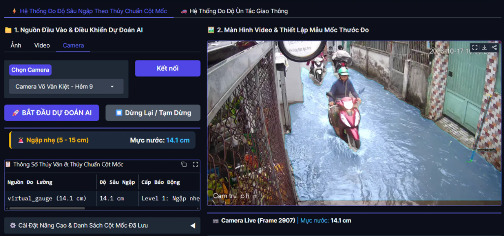
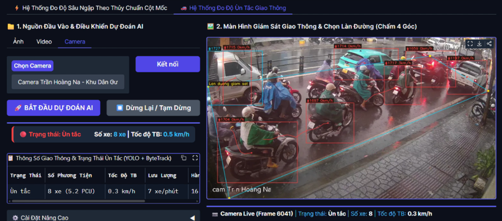

# 🌊 AI-Powered Urban Flood Depth & Traffic Congestion Monitoring System
### *Hệ Thống Trí Tuệ Nhân Tạo Giám Sát Mực Nước Ngập & Mật Độ Giao Thông Đô Thị Thời Gian Thực*

[](https://www.python.org/)
[](https://github.com/ultralytics/ultralytics)
[](https://pytorch.org/)
[](https://gradio.app/)
[](LICENSE)

---

## 📌 Giới Thiệu Tổng Quan

Hệ thống kết hợp thị giác máy tính tiên tiến (**Dual YOLOv8 + ByteTrack + SCSG-Net**) để giải quyết hai bài toán cấp thiết trong quản lý đô thị thông minh: **đo lường độ sâu ngập lụt theo thời gian thực** và **giám sát mức độ ùn tắc giao thông** thông qua hệ thống camera an ninh/giao thông sẵn có (RTSP / CCTV) mà không yêu cầu lắp đặt thêm các cảm biến thủy văn vật lý ngầm tốn kém.

> 🎬 **Video Demo Trực Quan:** [Xem toàn bộ video demo thực tế trên Google Drive](https://drive.google.com/drive/folders/1fL-NHAd-ckkwjHxJzhM5UuFgKY-9o2hA?usp=sharing)

---

## 🚀 Hai Phân Hệ Chính (Core Modules)

### 1. ⚡ Hệ Thống Đo Độ Sâu Ngập Theo Thủy Chuẩn Cột Mốc
Hệ thống sử dụng mạng lưới thủy chuẩn ảo kết hợp phân đoạn hình ảnh để tính toán chính xác cao độ mặt nước ngập (cm) và cảnh báo nguy cơ ngập tức thời.



* **Phân đoạn mặt nước (YOLOv8s-seg):** Mô hình được huấn luyện đặc thù trên **5,090 ảnh ngập lụt thực tế tại Việt Nam**, có khả năng phân tách chính xác ranh giới nước ngập trong nhiều điều kiện phức tạp (mưa lớn, ánh sáng khúc xạ, nước đục phù sa).
* **Mốc thủy chuẩn ảo (Virtual Staff Gauge - SCSG-Net):** Xây dựng theo tiêu chuẩn USGS TM 3-A7 và ISO 4373:2022. Ánh xạ phi tuyến phối cảnh (Perspective LUT) từ chân cọc đến đỉnh cọc giúp hiệu chỉnh sai số góc nhìn camera.
* **Thuật toán Constrained Change-Point:** Tự động phát hiện điểm ngắt giao cắt giữa mép nước và cột mốc, khử nhiễu gợn sóng và vật cản che khuất.
* **Phân cấp cảnh báo thông minh:** Phân loại tự động theo 4 cấp độ: *Không ngập / Ngập nhẹ (5 - 15 cm) / Ngập vừa (15 - 25 cm) / Ngập sâu nguy hiểm (> 25 cm)*.

---

### 2. 🚗 Hệ Thống Đo Độ Ùn Tắc Giao Thông
Phân hệ giám sát lưu lượng và đánh giá độ ùn tắc của phương tiện qua làn đường được chọn lọc theo thời gian thực.



* **Nhận diện & Bám vết đa phương tiện (YOLOv8s + ByteTrack):** Phát hiện và theo dõi liên tục quỹ đạo chuyển động của các loại phương tiện đặc trưng đô thị: xe máy, ô tô con, SUV, xe buýt, xe tải.
* **Vùng quan sát ROI tứ giác linh hoạt (4-Point Polygon):** Cho phép người vận hành chọn 4 điểm bất kỳ trên khung hình để khoanh vùng đoạn đường hoặc làn đường cần kiểm soát.
* **Chuẩn hóa tải lượng PCU & Vận tốc tức thời:** Tự động quy đổi tỷ lệ các loại xe về đơn vị xe con tiêu chuẩn (**Passenger Car Unit - PCU**), đo vận tốc trung bình (km/h) và lưu lượng xe/phút.
* **Cảnh báo trạng thái ùn tắc tức thì:** Phân cấp trạng thái 4 mức độ: *Thông thoáng 🟢, Đông đúc 🟡, Ùn ứ 🟠, Ùn tắc nghiêm trọng 🔴*.
* **Nhật ký dữ liệu lịch sử:** Tích hợp SQLite database lưu trữ lịch sử lưu lượng để trích xuất báo cáo thống kê giao thông đô thị.

---

## 🧠 Kiến Trúc Mô Hình AI (Model Weights)

| Mô hình | Trọng số | Kích thước | Nhiệm vụ chính |
| :--- | :--- | :--- | :--- |
| **Flood Segmentation** | `vietnam_flood_yolov8s_seg.pt` | **23.86 MB** | Phân đoạn vùng nước ngập đô thị (Fine-tuned trên 5,090 ảnh VN) |
| **Vehicle Tracking** | `yolov8s_vehicle.pt` | **22.59 MB** | Phát hiện & bám vết phương tiện giao thông (ByteTrack) |

---

## 🛠️ Hướng Dẫn Cài Đặt & Chạy Cục Bộ

### 1. Yêu Cầu Môi Trường
* Python 3.10 trở lên
* CUDA 11.8+ (khuyên dùng để đạt tốc độ FPS thời gian thực) hoặc CPU

### 2. Cài Đặt Thư Viện
```bash
git clone https://github.com/SYNEXAN/AI-Urban-Flood-Traffic.git
cd AI-Urban-Flood-Traffic
pip install -r requirements.txt
```

### 3. Khởi Chạy Ứng Dụng
```bash
python app.py
```
Sau khi khởi động, truy cập giao diện trên trình duyệt tại: `http://localhost:7860`

---

## 📹 Nguồn Dữ Liệu Đầu Vào Hỗ Trợ
* **Ảnh tĩnh (Image):** Định dạng `.jpg`, `.png`, `.jpeg`.
* **Video ngoại tuyến (Video):** Định dạng `.mp4`, `.avi`, `.mov`.
* **Camera giám sát trực tuyến (Live RTSP / HLS Stream):** Tích hợp sẵn camera giám sát đô thị (hỗ trợ giao thức RTSP qua TCP tối ưu độ ổn định).

---

## 📄 Bản Quyền (License)
Dự án được phân phối dưới giấy phép [MIT License](LICENSE).
